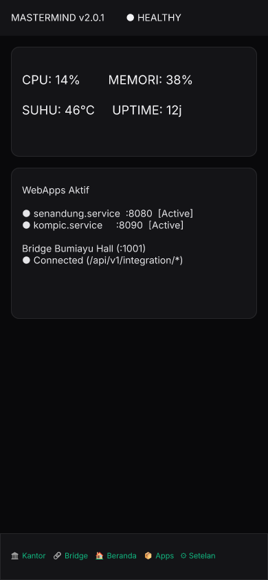

# 🧠 Mastermind

App manager **ultra-ringan** berbasis **Rust** (single static binary) untuk **STB HG680P / Odroid C2** di **DietPi / Debian**.

## 📱 Preview Tampilan (v2.0.1)

| Desktop (7 Tab + Large Metrics) | Mobile (5 Tab Bottom Bar) |
|---|---|
|  |  |

---

## 🗺️ Peta Konsep Kerja (Arsitektur v2.0.1)

```text
+-------------------------------------------------------------------+
|                   Bumiayu Hall (Port 1001)                        |
|        Windows Mobile / Metro Tiles Launcher & PWA Client         |
+---------------------------------+---------------------------------+
                                  |
         GET /api/v1/integration/manifest (X-Bumiayu-Bridge-Token)
         POST /api/v1/integration/control  (Execution-Only)
         Reverse Proxy: /p/<slug>/
                                  v
+-------------------------------------------------------------------+
|               Mastermind Core Engine v2.0.1 (Rust)                |
|  - Auth & Root Shell Escalation (Argon2id + 2FA)                  |
|  - Integration API Engine (src/api/integration.rs)                |
|  - Centralized Reverse Proxy (/p/<slug>/)                         |
|  - Systemd Core Service (src/executor.rs)                         |
+---------------------------------+---------------------------------+
                                  |
             systemctl start | stop | restart bumiayu-*
                                  v
+-------------------------------------------------------------------+
|                Linux OS Host (Shared Environment)                 |
|  - /etc/systemd/system/bumiayu-*.service (WebApps GUI + Port)     |
|  - Global CLI Tools: yt-dlp, ffmpeg, python3, node                |
+-------------------------------------------------------------------+
```

---

## ⚡ Instalasi, Konfigurasi, Update, & Pencopotan (v2.0.1)

### 1. Instalasi Cepat (1 Baris Perintah)
```sh
curl -fsSL https://raw.githubusercontent.com/faisalfa123/mastermind/main/deploy/install.sh -o /tmp/install.sh && sudo sh /tmp/install.sh
```

### 2. Konfigurasi Awal (`sudo mastermind setup`)
Wizard TUI akan menuntun Anda menyetel:
- **IP Bind & Port**: Pilih IP LAN / Tailscale (`100.x.y.z`) dan port HTTPS (default `8443`).
- **Akun Admin & 2FA**: Password di-hash dengan **Argon2id**, ditambah 2FA (TOTP / Pertanyaan Keamanan).
- **Bridge Token (`X-Bumiayu-Bridge-Token`)**: Otomatis di-generate dan ditampilkan di akhir wizard untuk disalin ke **Bumiayu Hall (Port 1001)**.

### 3. Update ke Versi Terbaru
```sh
curl -fsSL https://raw.githubusercontent.com/faisalfa123/mastermind/main/deploy/update.sh -o /tmp/update.sh && sudo sh /tmp/update.sh
```

### 4. Pencopotan (Uninstall)
Gunakan skrip otomatis (akan menanyakan apakah data `/etc/mastermind` & `/var/lib/mastermind` ikut dihapus):
```sh
curl -fsSL https://raw.githubusercontent.com/faisalfa123/mastermind/main/deploy/uninstall.sh -o /tmp/uninstall.sh && sudo sh /tmp/uninstall.sh
```
Atau secara manual:
```sh
sudo systemctl stop mastermind-web mastermind-helper
sudo systemctl disable mastermind-web mastermind-helper
sudo rm -f /etc/systemd/system/mastermind-web.service /etc/systemd/system/mastermind-helper.service /usr/local/bin/mastermind
sudo systemctl daemon-reload
```

---

## 📦 Opsi Menggunakan Versi 1 (`v1.0.0` Legacy Sandbox)

Jika Anda masih membutuhkan arsitektur **V1 Sandbox** (`DynamicUser=yes`, `batasan.toml`, dan anti-malware scanner), gunakan rilis **`v1.0.0`** dari branch **`v1-sandbox-legacy`**:
```sh
sudo curl -fsSL https://github.com/faisalfa123/mastermind/releases/download/v1.0.0/mastermind-linux-arm64 -o /usr/local/bin/mastermind
sudo chmod +x /usr/local/bin/mastermind
sudo mastermind setup
```

---

## 📜 Changelog & Sistem Versi (`A.B.CC`)
Lihat catatan rilis lengkap di [CHANGELOG.md](CHANGELOG.md):
- **`v2.0.1`**: Native Systemd Orchestrator, API Integrasi Bumiayu Hall (`/api/v1/integration/*`), Reverse Proxy `/p/<slug>/`, dan Dual-Layout UI (Desktop 7 Tab / Mobile 5 Tab).
- **`v1.0.0`**: Rilis final arsitektur Sandbox V1 (`v1-sandbox-legacy`).
