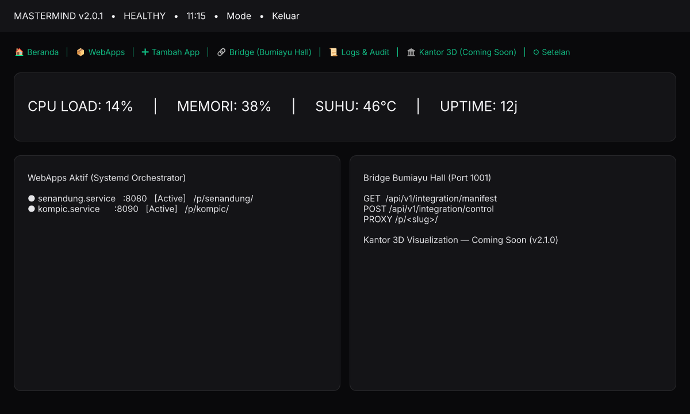

# 🧠 Mastermind



App manager **ultra-ringan** berbasis **Rust** (single static binary) untuk **STB HG680P / Odroid C2** di **DietPi / Debian**.

Tersedia dalam dua generasi arsitektur:
- **v2.0.1 (Main / Aktif)**: **Native Systemd Orchestrator & API Provider** untuk **Bumiayu Hall** (Shared Environment, tanpa sandboxing kaku).
- **v1.0.0 (Legacy / Branch `v1-sandbox-legacy`)**: **Sandbox App Manager** dengan isolasi `DynamicUser=yes` & `batasan.toml`.

---

## 🏗️ Arsitektur Sistem (v2.0.1)

```text
+-------------------------------------------------------------------+
|                   Bumiayu Hall (Port 1001)                        |
|        Windows Mobile / Metro Tiles Launcher & PWA Client         |
+---------------------------------+---------------------------------+
                                  |
         GET /api/v1/integration/manifest (X-Bumiayu-Bridge-Token)
         POST /api/v1/integration/control  (Execution-Only)
         Reverse Proxy: /p/<slug>/
                                  v
+-------------------------------------------------------------------+
|               Mastermind Core Engine v2.0.1 (Rust)                |
|  - Auth & Root Shell Escalation (Argon2id + 2FA)                  |
|  - Integration API Engine (src/api/integration.rs)                |
|  - Centralized Reverse Proxy (/p/<slug>/)                         |
|  - Systemd Core Service (src/executor.rs)                         |
+---------------------------------+---------------------------------+
                                  |
             systemctl start | stop | restart bumiayu-*
                                  v
+-------------------------------------------------------------------+
|                Linux OS Host (Shared Environment)                 |
|  - /etc/systemd/system/bumiayu-*.service (WebApps GUI + Port)     |
|  - Global CLI Tools: yt-dlp, ffmpeg, python3, node                |
+-------------------------------------------------------------------+
```

---

## ✨ Fitur Utama v2.0.1
- **Native Systemd Orchestrator (`src/executor.rs`)**: Mengelola unit `/etc/systemd/system/bumiayu-*.service` secara native dengan verifikasi **Password Root Shell** saat registrasi WebApp baru.
- **Filter Ketat Anti-CLI**: Hanya menerima WebApps GUI yang mendengarkan port HTTP/HTTPS aktif; alat CLI (`yt-dlp`, `ffmpeg`, `smb`, dll.) ditolak dari manifes dasbor dan tetap hidup sebagai dependensi global OS.
- **Otoritas Terbatas (Execution-Only)**: Hanya mengontrol status service (`start|stop|restart`) dan memantau metrik hardware (CPU, RAM, Suhu, Uptime).
- **API Integrasi Bumiayu Hall (`src/api/integration.rs`)**:
  - `GET /api/v1/integration/manifest` (terproteksi `X-Bumiayu-Bridge-Token`)
  - `POST /api/v1/integration/control`
  - Centralized Reverse Proxy `/p/<slug>/` (anti-keluar PWA iOS Safari).
- **Dual-Layout UI**: Desktop 7 Tab (`Kantor 3D`, `Bridge`, `Beranda`, `WebApps`, `Tambah App`, `Logs & Audit`, `Setelan`) dan Mobile Bottom Bar 5 Tab.

---

## ⚡ Cara Install & Update v2.0.1 (Main)

### 1. Instalasi Cepat (1 Baris Perintah)
Jalankan langsung di terminal **Odroid C2 / STB HG680P (DietPi/Debian)**:
```sh
curl -fsSL https://raw.githubusercontent.com/faisalfa123/mastermind/main/deploy/install.sh -o /tmp/install.sh && sudo sh /tmp/install.sh
```
Installer TUI akan otomatis:
1. Mengunduh binary `mastermind-linux-arm64` dari rilis terbaru.
2. Membuat user sandbox `mastermind` & unit `mastermind-helper` + `mastermind-web`.
3. Menjalankan **Setup Wizard (`sudo mastermind setup`)** untuk menyetel IP Bind (LAN/Tailscale), Admin + 2FA, serta men-generate **`X-Bumiayu-Bridge-Token`**.

### 2. Update ke Versi Terbaru
```sh
curl -fsSL https://raw.githubusercontent.com/faisalfa123/mastermind/main/deploy/update.sh -o /tmp/update.sh && sudo sh /tmp/update.sh
```

---

## 📦 Mastermind v1.0.0 (Legacy Sandbox Edition)

Versi **v1.0.0** menggunakan arsitektur **Sandbox** (`DynamicUser=yes`, `batasan.toml`, dan anti-malware scanner) yang terpisah di branch **`v1-sandbox-legacy`** dan tag **`v1.0.0`**.

### Cara Install v1.0.0 (Manual)
```sh
# 1. Unduh binary v1.0.0 untuk ARM64
sudo curl -fsSL https://github.com/faisalfa123/mastermind/releases/download/v1.0.0/mastermind-linux-arm64 -o /usr/local/bin/mastermind
sudo chmod +x /usr/local/bin/mastermind

# 2. Jalankan Setup Wizard
sudo mastermind setup
```
Atau clone langsung branch legacy-nya:
```sh
git clone -b v1-sandbox-legacy https://github.com/faisalfa123/mastermind.git
cd mastermind
sudo sh deploy/install.sh
```

---

## 🏷️ Sistem Versi (`A.B.CC`)
Lihat riwayat perubahan lengkap di [CHANGELOG.md](CHANGELOG.md):
- **`A`**: Main / Stable Release (`v1.0.0`, `v2.0.1`)
- **`B`**: Beta / Unstable Release (penambahan fitur baru)
- **`CC`**: Canary / Nightly Release (perbaikan bug cepat)
